# Diseño del Sistema y Arquitectura de Software

**Documento:** ARCH-DESIGN-001  
**Versión:** 1.0.0  
**Fecha:** 15 de noviembre de 2026  
**Autor:** Senior Software Architect  

---

## 1. Visión General de la Arquitectura Frontend

El portafolio se estructura como una **Single Page Application (SPA) modular y orientada a componentes** desarrollada con **React 19 + TypeScript + Vite**. Aplica principios de alta cohesión y bajo acoplamiento, separando estrictamente la presentación de la lógica de estado y los datos estáticos verificados.

No se incorpora backend propio ni bases de datos activas en el portafolio; todo el contenido proviene de modelos de datos tipados inmutables (`content/`), asegurando tiempos de respuesta subsegundo, costo operativo cero y máxima seguridad.

---

## 2. Diagrama de Arquitectura de Componentes

El siguiente diagrama modela la jerarquía y relaciones entre módulos:

```mermaid
graph TD
    subgraph Core ["Capa Core & Bootstrap"]
        App["App.tsx (Root Provider & Router)"]
        ThemeInit["theme-init.js (Inline Script Zero-FOUT)"]
        I18nConfig["i18n.ts (react-i18next Configuration)"]
        ThemeProvider["ThemeProvider (Context & State)"]
    end

    subgraph Layout ["Capa Layout"]
        AppLayout["AppLayout.tsx"]
        Navbar["Navbar.tsx (Desktop + Mobile Sheet)"]
        Footer["Footer.tsx (Social Links & Legal)"]
        ThemeToggle["ThemeToggle.tsx (Light/Dark/System)"]
        LanguageToggle["LanguageToggle.tsx (ES/EN)"]
    end

    subgraph Pages ["Capa Vistas (Pages)"]
        HomePage["HomePage.tsx (/)"]
        ProjectsCatalogPage["ProjectsCatalogPage.tsx (/projects)"]
        ProjectDetailPage["ProjectDetailPage.tsx (/projects/:slug)"]
        NotFoundPage["NotFoundPage.tsx (*)"]
    end

    subgraph Sections ["Capa Secciones de Home"]
        HeroSec["HeroSection.tsx (#hero)"]
        AboutSec["AboutSection.tsx (#about)"]
        SkillsSec["SkillsSection.tsx (#skills)"]
        FeaturedSec["FeaturedProjectsSection.tsx (#featured-projects)"]
        EducationSec["EducationSection.tsx (#education)"]
        CVSec["CVSection.tsx (#cv)"]
        ContactSec["ContactSection.tsx (#contact)"]
    end

    subgraph ProjectComponents ["Capa Componentes de Proyectos"]
        ProjectCard["ProjectCard.tsx"]
        ProjectFilters["ProjectFilters.tsx (Category Tabs)"]
        ProjectSearch["ProjectSearch.tsx (Debounced Input)"]
        CaseStudyHeader["CaseStudyHeader.tsx"]
        ArchitectureSection["ArchitectureSection.tsx (C4 / Diagrams)"]
        TechBadgeList["TechBadgeList.tsx"]
        RelatedProjects["RelatedProjects.tsx"]
    end

    subgraph UIPrimitives ["Capa UI Primitives (shadcn/ui & Radix)"]
        Button["Button.tsx"]
        Badge["Badge.tsx"]
        Card["Card.tsx"]
        Tabs["Tabs.tsx"]
        Dialog["Dialog.tsx / Sheet.tsx"]
        Tooltip["Tooltip.tsx"]
    end

    subgraph DataLayer ["Capa Contenido & Tipos"]
        ProjectData["projects.ts (Verified Case Studies)"]
        EducationData["education.ts (Degrees & Certs)"]
        ContentModels["types/index.ts (TypeScript Interfaces)"]
    end

    ThemeInit --> App
    App --> ThemeProvider
    App --> I18nConfig
    App --> AppLayout
    AppLayout --> Navbar
    AppLayout --> Footer
    Navbar --> ThemeToggle
    Navbar --> LanguageToggle

    AppLayout --> HomePage
    AppLayout --> ProjectsCatalogPage
    AppLayout --> ProjectDetailPage
    AppLayout --> NotFoundPage

    HomePage --> HeroSec
    HomePage --> AboutSec
    HomePage --> SkillsSec
    HomePage --> FeaturedSec
    HomePage --> EducationSec
    HomePage --> CVSec
    HomePage --> ContactSec

    FeaturedSec --> ProjectCard
    ProjectsCatalogPage --> ProjectFilters
    ProjectsCatalogPage --> ProjectSearch
    ProjectsCatalogPage --> ProjectCard

    ProjectDetailPage --> CaseStudyHeader
    ProjectDetailPage --> ArchitectureSection
    ProjectDetailPage --> TechBadgeList
    ProjectDetailPage --> RelatedProjects

    ProjectCard --> UIPrimitives
    FeaturedSec --> UIPrimitives
    AboutSec --> UIPrimitives

    ProjectData --> ContentModels
    EducationData --> ContentModels
    ProjectData -.-> FeaturedSec
    ProjectData -.-> ProjectsCatalogPage
    ProjectData -.-> ProjectDetailPage
```



---

## 3. Modelo de Responsabilidades por Capa

1. **`app/`**: Inicialización del enrutador, proveedores globales de contexto (`ThemeProvider`, `I18nextProvider`, `Toaster`).
2. **`layout/`**: Estructura perimetral persistente. Maneja la cabecera fija, pie de página, menús adaptativos de navegación y cálculo del scroll de anclas.
3. **`pages/`**: Vistas de nivel superior asociadas a URLs. Coordinan la obtención de parámetros (`useParams`), títulos de página (`document.title`), etiquetas SEO y composición de secciones.
4. **`sections/`**: Secciones independientes diseñadas para coexistir en la página principal (`HomePage`), cada una con un identificador HTML unívoco para scroll de anclas (`id="skills"`, etc.).
5. **`components/projects/`**: Componentes especializados en la presentación y exploración del inventario técnico: tarjetas, filtros interactivos, visualizadores de casos de estudio y recomendaciones.
6. **`components/ui/`**: Componentes reutilizables atómicos y de diseño base (botones, badges, tarjetas, modales), desacoplados del dominio de negocio y basados en Radix UI.
7. **`data/`**: Fuentes de verdad tipadas inmutables que contienen los casos de estudio reales, certificaciones, trayectoria y metadatos.
8. **`hooks/`**: Lógica de interacción reutilizable (`useTheme`, `useScrollSpy`, `useMediaQuery`, `useDebounce`).
9. **`types/`**: Contratos e interfaces estrictos en TypeScript que garantizan la integridad de los datos.

---

## 4. Estrategia de Enrutamiento y Navegación Híbrida

La navegación híbrida resuelve de forma elegante la dualidad entre un portafolio de impacto rápido (one-page scroll) y la profundidad de ingeniería que exige un reclutador senior (páginas dedicadas de proyectos):

| Ruta | Tipo de Vista | Comportamiento de Navegación |
|---|---|---|
| `/` | One-Page Híbrida | Permite scroll vertical libre o salto instantáneo suave a anclas (`#about`, `#skills`, `#featured-projects`, `#education`, `#cv`, `#contact`). |
| `/projects` | Catálogo Completo | Vista independiente con filtros por categoría, búsqueda instantánea y paginación o listado completo. |
| `/projects/:slug` | Caso de Estudio Profundo | Página individual con análisis técnico completo, diagramas C4 y contribuciones de ingeniería. Permite deep linking directo para compartir con reclutadores. |
| `*` | Error 404 Resiliente | Captura de rutas inválidas con botón de retorno al catálogo. |

### Sincronización de Anclas entre Rutas
Cuando un usuario hace clic en un enlace de sección (ej. "Tecnologías") estando en `/projects/capital-cruise`:
1. El enrutador navega a `/#skills`.
2. Al montar la vista `HomePage`, un hook especializado (`useHashScroll`) detecta el hash en la URL (`window.location.hash`).
3. Tras completarse el renderizado del DOM, se ejecuta `element.scrollIntoView({ behavior: 'smooth' })`.

---

## 5. Prevención de Flash of Unstyled Theme (Zero-FOUT)

Para evitar que un usuario en modo oscuro experimente un destello blanco al cargar la aplicación, se implementa la siguiente secuencia:

1. En `index.html`, dentro de la etiqueta `<head>` y antes de cualquier archivo CSS o script de React, se ejecuta un script inline síncrono:
   ```javascript
   (function() {
     try {
       const storedTheme = localStorage.getItem('portfolio-theme');
       const systemPrefersDark = window.matchMedia('(prefers-color-scheme: dark)').matches;
       if (storedTheme === 'dark' || (!storedTheme && systemPrefersDark)) {
         document.documentElement.classList.add('dark');
       } else {
         document.documentElement.classList.remove('dark');
       }
     } catch (e) {}
   })();
   ```
2. Cuando el `ThemeProvider` de React se inicializa, lee el estado de la clase en `document.documentElement` y sincroniza el estado de React sin provocar re-renders visibles ni parpadeos.

---

## 6. Política de Seguridad y Enlaces Externos

- Todos los enlaces a repositorios de GitHub, perfiles sociales o demos externas deben incluir los atributos de seguridad:
  `target="_blank" rel="noopener noreferrer"`.
- No se permiten llamadas a scripts externos de tracking no consentidos.
- Las imágenes y recursos gráficos se sirven localmente desde `public/assets/` o carpetas de recursos optimizados para evitar bloqueos por CORS o caídas de hosts de terceros.
