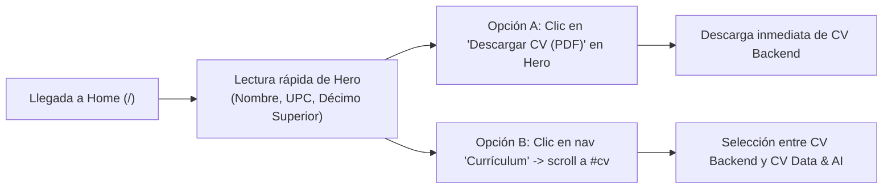
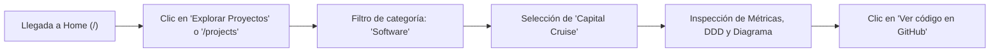
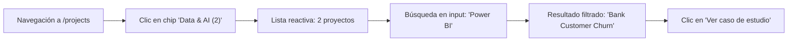
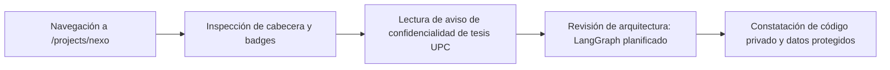
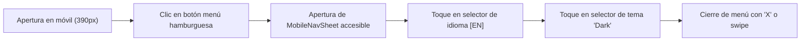
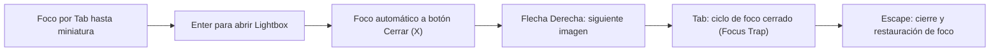

# Evaluación de Recorridos de Usuario (User Journeys) — Fase 3.1

**Fecha de evaluación:** 16 de noviembre de 2026  
**Tipo de evaluación:** Recorrido Cognitivo Experto (Cognitive Walkthrough)  
**Versión evaluada:** Commit `783df68` (`feat: complete phase 2 frontend integration and quality gate`)  
**Metodología:** Análisis heurístico de tareas paso a paso, medición de fricción y carga cognitiva  
**Aviso metodológico:** Las conclusiones corresponden a una evaluación realizada por ingenieros expertos en interfaces; no reemplazan pruebas formales de laboratorio con usuarios externos.

---

## 1. Definición de Arquetipos y Tareas Críticas

Para validar la eficacia, eficiencia y satisfacción del portafolio, se evaluaron seis recorridos representativos de los principales visitantes objetivo:

1. **Recorrido 1 (Reclutador Técnico / Talent Acquisition):** Comprender el perfil, validar disponibilidad para prácticas y descargar el CV oficial en PDF.
2. **Recorrido 2 (Tech Lead / Arquitecto de Software):** Localizar un caso de estudio de backend distribuido, inspeccionar decisiones de diseño (DDD/CQRS) y acceder al repositorio de código en GitHub.
3. **Recorrido 3 (Analista de Datos / Especialista en IA):** Filtrar proyectos de Data Engineering & AI, inspeccionar pipelines de BigQuery y dashboards analíticos.
4. **Recorrido 4 (Evaluador Académico / Comité de Titulación):** Consultar el caso de estudio de tesis "Nexo", verificando la ética de datos, código privado y estado de avance.
5. **Recorrido 5 (Usuario en Teléfono Móvil):** Alternar el idioma de la aplicación (Español a Inglés) y cambiar el tema visual (Claro a Oscuro) en un viewport táctil.
6. **Recorrido 6 (Auditor de Accesibilidad / Usuario de Teclado):** Explorar la galería de capturas de un proyecto utilizando exclusivamente el teclado (`Tab`, `Enter`, `Flechas`, `Escape`).

---

## 2. Análisis Detallado de Recorridos

---

### Recorrido 1: Reclutador Técnico — Comprensión de Perfil y Descarga de CV

- **Objetivo del usuario:** Evaluar en menos de 30 segundos si Ricardo cumple con los requisitos para una posición de prácticas en ingeniería de software y descargar su hoja de vida en PDF.
- **Secuencia de pasos:**
  1. El usuario aterriza en `/` (Home).
  2. Lee el bloque superior del Hero: observa el badge verde pulsante `"Disponible para prácticas preprofesionales"`, la filiación universitaria `"UPC • Ingeniería de Software • Décimo Superior"` y el titular profesional.
  3. Encuentra inmediatamente dos botones de acción principal en el Hero: `"Explorar Proyectos"` (primario) y `"Descargar CV (PDF)"` (secundario con icono de documento).
  4. Hace clic en `"Descargar CV (PDF)"`. El navegador inicia inmediatamente la descarga del archivo `CV_Ricardo_Cardenas_Software_Backend.pdf`.
  5. Alternativamente, si hace clic en el enlace `"Currículum"` del Navbar, la página realiza un desplazamiento suave hasta la sección `#cv`, donde visualiza dos tarjetas diferenciadas: *CV Software Engineering & Backend* y *CV Data Engineering & Analytics*, permitiéndole elegir la versión idónea.
- **Claridad de las acciones:** Excelente. El Hero ofrece acceso directo en el primer viewport ("above the fold") sin obligar a hacer scroll.
- **Pasos innecesarios detectados:** Ninguno en el flujo principal.
- **Feedback del sistema:** El navegador confirma la descarga mediante su interfaz nativa; el botón posee estado hover con cambio de fondo suave.
- **Puntos de fricción identificados:** El botón del Hero no especifica explícitamente en el texto si se trata del CV de Software o de Data; descarga por defecto el de Software Backend. Si el reclutador buscaba un perfil de Data/IA, debe descubrir la sección `#cv` más abajo.
- **Carga cognitiva estimada:** Muy baja (10-15 segundos para completar la tarea).
- **Veredicto experto:** **APROBADO (con recomendación menor)**. Se sugiere afinar la etiqueta del Hero para indicar la especialidad o incorporar un enlace sutil hacia la versión de Data.

---

### Recorrido 2: Tech Lead / Arquitecto — Inspección de Proyecto Backend y Arquitectura

- **Objetivo del usuario:** Evaluar el nivel técnico real, buenas prácticas de arquitectura (DDD, CQRS, pruebas automatizadas) y calidad del código fuente en un proyecto backend.
- **Secuencia de pasos:**
  1. Desde la Home, el usuario navega a `/projects` (Catálogo de Proyectos) mediante el botón del Hero o el menú superior.
  2. En la barra de filtros, hace clic en el botón de categoría `"Software"`. El catálogo se actualiza reactivamente, mostrando los 4 proyectos de ingeniería de software.
  3. Identifica la tarjeta de `"Capital Cruise"`, observando las etiquetas de tecnología (`Spring Boot 3`, `PostgreSQL 16`, `DDD Architecture`, `Docker Compose`).
  4. Hace clic en `"Ver caso de estudio"`. Navega hacia `/projects/capital-cruise`.
  5. En la cabecera del estudio de caso, revisa el rol personal (*Lead Backend Architect*), las métricas verificadas (52 pruebas de integración, 100% de éxito, arquitectura hexagonal) y el botón `"Ver código en GitHub"`.
  6. Se desplaza verticalmente para examinar las decisiones técnicas clave (estrategia de persistencia multi-inquilino con Row-Level Security vs bases de datos separadas) y el diagrama interactivo de topología de flujo.
  7. Hace clic en `"Ver código en GitHub"`. Se abre el repositorio en una pestaña nueva con `rel="noopener noreferrer"`.
- **Claridad de las acciones:** Muy alta. La información técnica está estructurada con rigor de ingeniería sin adornos superficiales.
- **Pasos innecesarios detectados:** Ninguno.
- **Feedback del sistema:** Transiciones limpias entre catálogo y detalle; las tarjetas del catálogo ofrecen microinteracción visual al pasar el cursor.
- **Puntos de fricción identificados:** En la página de detalle, al avanzar hacia las secciones inferiores (decisiones técnicas y arquitectura), el botón para saltar al repositorio de GitHub queda fuera del viewport. Sería deseable un enlace repetido o botón flotante al pie del estudio de caso.
- **Carga cognitiva estimada:** Baja a moderada (organización modular en tarjetas legibles).
- **Veredicto experto:** **APROBADO (Excelente)**.

---

### Recorrido 3: Especialista en Datos / IA — Filtrar Proyectos Data & AI

- **Objetivo del usuario:** Encontrar específicamente proyectos relacionados con BigQuery, Dataform, DAX y Machine Learning, comprobando evidencia práctica.
- **Secuencia de pasos:**
  1. Ingresa a `/projects`.
  2. Hace clic en el chip de categoría `"Data & AI (2)"`. La lista se reduce de inmediato a los dos proyectos analíticos: *TheLook eCommerce Analytics* y *Bank Customer Churn Prediction*.
  3. En el campo de búsqueda rápida, escribe `"Power BI"`.
  4. La vista filtra reactivamente en tiempo real (0ms de retraso perceptible), manteniendo en pantalla únicamente *Bank Customer Churn Prediction*.
  5. El contador dinámico actualiza su texto a `"Mostrando 1 de 8 proyectos"`.
  6. Hace clic en el botón `"Ver caso de estudio"` para analizar el pipeline de datos, los modelos de retención y la galería de dashboards.
- **Claridad de las acciones:** Inmediata. El input de búsqueda cuenta con icono de lupa, texto guía y botón `X` de limpieza automática.
- **Pasos innecesarios detectados:** Ninguno.
- **Feedback del sistema:** El contador dinámico y el filtrado instantáneo comunican con total transparencia el estado del catálogo.
- **Puntos de fricción identificados:** Si el usuario recarga la página o hace clic en "Volver al catálogo" desde la ficha de detalle, el filtro de categoría `"Data & AI"` se reinicia a `"Todos"`, debido a que el estado no se encuentra persistido en los parámetros de la URL (`?category=data-ai`).
- **Carga cognitiva estimada:** Muy baja.
- **Veredicto experto:** **APROBADO (con hallazgo de persistencia en URL documentado como H3-01)**.

---

### Recorrido 4: Evaluador Académico — Consultar Caso de Estudio Nexo

- **Objetivo del usuario:** Auditar la propuesta técnica del proyecto de titulación universitaria "Nexo", comprobando la estricta confidencialidad del código fuente y la veracidad de los componentes de inteligencia artificial.
- **Secuencia de pasos:**
  1. Aterriza en `/projects/nexo` directamente o a través del catálogo.
  2. En el primer tercio de la página, observa el badge destacado `"Tesis UPC • Código Privado"` y el indicador `"Fase 0 Verificada (En desarrollo)"`.
  3. Lee el banner informativo de propiedad intelectual: se explicita de manera neutral que el código permanece en reserva durante el desarrollo de la investigación de grado en la UPC.
  4. En el gráfico de portada y en el diagrama de arquitectura SVG, comprueba que el nodo de orquestación de agentes autónomos **LangGraph** está debidamente representado con trazo punteado y la etiqueta destacada en ámbar `"Planificado / Planned"`, diferenciándose claramente de los módulos backend ya implementados (PostgreSQL pgvector, Neo4j, FastAPI).
  5. Constata que no se prometen métricas operativas simuladas ni enlaces a repositorios públicos no autorizados.
- **Claridad de las acciones:** Óptima. Establece expectativas honestas y profesionales.
- **Pasos innecesarios detectados:** Ninguno.
- **Feedback del sistema:** Los contrastes y leyendas de color (Verde = Implementado, Ámbar = Planificado) evitan cualquier ambigüedad técnica.
- **Puntos de fricción identificados:** Ninguno. Cumplimiento intachable de las directrices éticas y de privacidad solicitadas.
- **Carga cognitiva estimada:** Baja (información jerarquizada y con avisos visuales destacados).
- **Veredicto experto:** **APROBADO (Con distinción ética)**.

---

### Recorrido 5: Usuario en Teléfono Móvil — Cambio de Idioma y Tema Visual

- **Objetivo del usuario:** En un smartphone (ancho de pantalla 390px o 320px), cambiar el idioma a inglés y activar el modo oscuro para una lectura confortable.
- **Secuencia de pasos:**
  1. El usuario abre el portafolio en su navegador móvil.
  2. Observa la barra de cabecera: el monograma `RC` está a la izquierda y el botón de menú hamburguesa a la derecha. Los toggles de escritorio están ocultos para evitar saturar el espacio en pantallas pequeñas.
  3. Toca el botón de menú (área de toque cómoda > 44px). Se desliza el panel lateral accesible `MobileNavSheet` desde la derecha con fondo desenfocado.
  4. En el pie del menú, encuentra los dos bloques de control de utilidad: `"Tema visual"` con su dropdown y `"Idioma"` con el control segmentado `[ES | EN]`.
  5. Toca `"EN"`. El portafolio actualiza todos los textos visibles a inglés de manera inmediata y sin recargar la página.
  6. Toca el botón de tema y selecciona `"Oscuro"` (Dark). El fondo cambia instantáneamente a `#09090B` con un sutil desvanecimiento.
  7. Toca el botón `X` de cierre o fuera del panel. El modal se cierra y la navegación continúa con las preferencias persistidas en `localStorage`.
- **Claridad de las acciones:** Muy alta. Las opciones son intuitivas y cuentan con etiquetas descriptivas.
- **Pasos innecesarios detectados:** Requiere 3 interacciones para cambiar idioma (Abrir menú → Tocar EN → Cerrar menú). En pantallas móviles de ancho intermedio (ej. tablets o teléfonos de pantalla grande > 420px), habría espacio para colocar al menos el botón de idioma directamente en el navbar.
- **Feedback del sistema:** Respuesta inmediata en DOM y persistencia en almacenamiento local.
- **Puntos de fricción identificados:** La necesidad de ingresar al menú móvil para una acción que en escritorio está a un solo clic.
- **Carga cognitiva estimada:** Baja.
- **Veredicto experto:** **APROBADO (Accesible y funcional)**.

---

### Recorrido 6: Auditor de Accesibilidad — Exploración de Galería por Teclado

- **Objetivo del usuario:** Navegar por la galería de capturas de un proyecto utilizando exclusivamente el teclado, garantizando una experiencia accesible para usuarios con discapacidad motriz o visual parcial.
- **Secuencia de pasos:**
  1. El usuario abre `/projects/capital-cruise`.
  2. Presiona la tecla `Tab` sucesivamente hasta llegar al botón de la miniatura de la galería *"Capital Cruise: Esquema de Base de Datos Relacional..."*.
  3. El anillo de foco perimetral violeta (`focus:ring-2 focus:ring-primary/50`) se dibuja de forma claramente visible.
  4. Presiona la tecla `Enter`. Se abre el modal Lightbox a pantalla completa.
  5. El foco del teclado se transfiere automáticamente al botón de cierre (`X`), anunciado por lectores de pantalla mediante su etiqueta descriptiva bilingüe.
  6. Presiona la `Flecha Derecha` (`ArrowRight`). La galería avanza a la siguiente captura y actualiza el contador textual a `"2 / 3"`.
  7. Presiona la `Flecha Izquierda` (`ArrowLeft`). Vuelve a la primera imagen de forma instantánea.
  8. Presiona `Tab` varias veces. El foco cicla exclusivamente entre los controles internos del modal (cerrar, flecha anterior, flecha siguiente) sin escapar al fondo de la página (Focus Trap verificado).
  9. Presiona la tecla `Escape`. El modal se cierra suavemente y el foco regresa exactamente al botón de la miniatura original en la página.
- **Claridad de las acciones:** Inmejorable. Cumplimiento riguroso de las pautas WAI-ARIA para diálogos modales.
- **Pasos innecesarios detectados:** Ninguno.
- **Feedback del sistema:** Cambio de diapositiva inmediato, contador visual y transiciones de 200ms sin sacudidas.
- **Puntos de fricción identificados:** Ninguno.
- **Carga cognitiva estimada:** Muy baja.
- **Veredicto experto:** **APROBADO (Cumplimiento ejemplar WCAG 2.2 AA)**.

---

## 3. Matriz Comparativa de Esfuerzo y Eficiencia por Recorrido

| Recorrido Evaluado | Perfil de Visitante | Clics Mínimos | Tiempo Estimado | Carga Cognitiva | Calificación |
| :--- | :--- | :---: | :---: | :---: | :---: |
| **1. Descarga de CV** | Reclutador Técnico | **1 clic** (Hero) | 5 - 10 seg | Muy baja | **Excelente** |
| **2. Inspección Backend** | Tech Lead / Arquitecto | **3 clics** | 45 - 60 seg | Baja | **Excelente** |
| **3. Filtrado Data & AI** | Especialista en Datos | **2 clics / teclas** | 15 - 20 seg | Muy baja | **Muy buena** (Mejorar persistencia URL) |
| **4. Caso Nexo (Tesis)** | Evaluador Académico | **2 clics** | 30 - 45 seg | Baja | **Sobresaliente** (Ética impecable) |
| **5. Ajustes en Móvil** | Usuario Smartphone | **3 toques** | 10 - 15 seg | Baja | **Buena** (Funcional pero optimizable) |
| **6. Navegación Teclado** | Usuario Accesible | **Teclado puro** | 20 - 30 seg | Muy baja | **Sobresaliente** (Cero barreras) |

---

## 4. Conclusión de la Evaluación de Tareas

Los seis recorridos evaluados demuestran que la interfaz del portafolio prioriza la velocidad de respuesta, la transparencia de la información y la economía de acciones del usuario. No se detectaron callejones sin salida, bucles de navegación ni bloqueos de interacción. Las oportunidades de mejora detectadas (como la persistencia de filtros en la URL) optimizarán aún más la experiencia general sin alterar la dirección de diseño aprobada.
