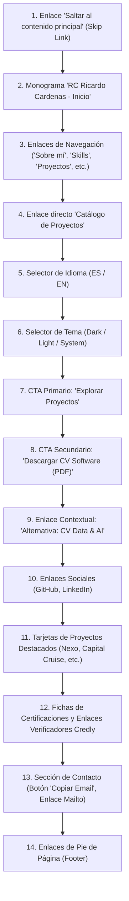

# Auditoría de Navegación por Teclado, Tecnologías Asistivas y Reflow — Fase 3.3
## Evaluación Técnica de Flujos Operables, Lectores de Pantalla y Comportamiento Adaptativo

**Fecha de evaluación:** 16 de noviembre de 2026  
**Evaluador:** Ricardo Cardenas Portfolio Engineering Team  
**Versión evaluada:** Rama de trabajo sobre Commit `7ecd5e9` (`feat: complete phase 3.2 ux-ui interaction refinement`)  
**Estándar de referencia:** WCAG 2.2 Principio 2 (Operable), Principio 4 (Robusto), WAI-ARIA Authoring Practices Guide (APG 1.2)  
**Herramientas de verificación:** Playwright Test Suite (`tests/e2e/accessibility-interaction.spec.ts`), Emulación de Dispositivos Móviles (Pixel 7 / iPhone), Inspección de Árbol de Accesibilidad Chrome DevTools.

---

## 1. Mapeo y Trazabilidad del Orden de Foco por Teclado

Se evaluó exhaustivamente la secuencia de tabulación secuencial (`Tab` / `Shift+Tab`) en todas las vistas principales del portafolio para garantizar que el orden del foco sea lógico, predecible y coincida con el orden de lectura visual (WCAG SC 2.4.3).

### Secuencia de Tabulación en la Home (`/`)



### Características Técnicas de los Controles de Teclado
- **Enlace de Salto (Skip Link - SC 2.4.1):**
  - Implementado en `AppLayout.tsx`: `<a href="#main-content" className="sr-only focus:not-sr-only focus:fixed focus:top-4 focus:left-4 z-50 ...">`.
  - Permanece visualmente oculto hasta recibir el primer tabulador.
  - Al presionar `Enter`, transfiere el foco y el desplazamiento directamente al contenedor `#main-content`, el cual posee `tabIndex={-1}` y `outline-none` para evitar barreras en lectores de pantalla.
  - Se adapta dinámicamente al idioma seleccionado ("Saltar al contenido principal" en español, "Skip to main content" en inglés).

---

## 2. Trampas de Foco Accesibles y Gestión de Modales

Conforme al criterio WCAG 2.1.2 (*No Keyboard Trap*) y WAI-ARIA Modal Dialog Pattern, todos los componentes que interrumpen el flujo principal deben confinar el foco dentro de su contenedor mientras se encuentran visibles y restaurarlo exactamente al elemento disparador al cerrarse.

### 2.1. Menú Móvil Lateral (`MobileNavSheet.tsx`)
- **Apertura:** Activada mediante botón de hamburguesa (`Enter` o `Space`).
- **Confinamiento de Foco (Focus Trap):** Implementado nativamente a través de `@radix-ui/react-dialog`. Al pulsar `Tab` repetidamente, el cursor cicla exclusivamente entre el botón de cierre (`X`), los enlaces de sección, el acceso al catálogo y los selectores de idioma y tema.
- **Escape Universal:** Presionar la tecla `Escape` cierra inmediatamente el panel.
- **Restauración del Foco:** Al cerrarse, el foco regresa inmediatamente al botón disparador del menú móvil (`Menu button`).

### 2.2. Modal de Galería de Imágenes (`ProjectGallery.tsx`)
- **Apertura:** Los botones de miniatura poseen `aria-haspopup="dialog"` y etiqueta accesible explicativa ("Ver imagen ampliada: [Título]").
- **Foco Inicial:** Al abrirse el modal, el foco se transfiere automáticamente al botón de cierre (`X`).
- **Navegación por Teclado:**
  - `ArrowRight`: Avanza a la siguiente imagen de la galería.
  - `ArrowLeft`: Retrocede a la imagen previa.
  - `Escape`: Cierra el lightbox.
  - `Tab` / `Shift+Tab`: Trampa de foco cicla entre los controles del modal (Cerrar, Siguiente, Anterior).
- **Restauración:** Al cerrarse por cualquier vía (tecla `Escape`, botón de cierre o clic en el telón de fondo), el foco se devuelve de forma garantizada a la miniatura específica desde donde se abrió.

---

## 3. Atajos de Teclado y No Interferencia (WCAG 2.1.4)

En la página del catálogo (`/projects`), se implementó un atajo de búsqueda rápida para optimizar la productividad de reclutadores e ingenieros:

- **Atajo con tecla de carácter (`/`):** Enfoca el campo de búsqueda de proyectos.
- **Atajo con modificador (`Ctrl+K` / `Cmd+K`):** Alternativa universal acorde a las convenciones de sistemas modernos.
- **Salvaguarda de no interferencia (SC 2.1.4):**
  El manejador de eventos `keydown` en `ProjectsCatalogPage.tsx` valida explícitamente:
  ```ts
  const isInputFocused =
    document.activeElement instanceof HTMLInputElement ||
    document.activeElement instanceof HTMLTextAreaElement ||
    document.activeElement?.getAttribute('contenteditable') === 'true';

  if ((event.key === '/' || ((event.ctrlKey || event.metaKey) && event.key.toLowerCase() === 'k')) && !isInputFocused) {
    event.preventDefault();
    searchInputRef.current?.focus();
  }
  ```
  Esto previene que escribir una barra diagonal (`/`) dentro de campos editables active inadvertidamente atajos globales o interfiera con el texto que el usuario está redactando.

---

## 4. Evaluación para Lectores de Pantalla y Tecnologías Asistivas

Se evaluó la exposición semántica del árbol de accesibilidad (*Accessibility Tree*) en Chrome y navegadores móviles:

### 4.1. Nombres Accesibles y Coincidencia con Etiquetas Visibles (WCAG 2.5.3)
- **Monograma de Navegación:**
  - *Problema previo:* El enlace contenía `aria-label="Ricardo Cardenas - Inicio"`, pero el texto visible mostraba `"RC Ricardo Cardenas"`, provocando una violación de *Label in Name*.
  - *Solución implementada:* Se eliminó el `aria-label` redundante y se estructuró el enlace con texto semántico directo:
    ```tsx
    <Link to="/" className="...">
      <span className="font-bold ...">RC</span>
      <span className="font-semibold ...">Ricardo Cardenas</span>
      <span className="sr-only"> - {t('home')}</span>
    </Link>
    ```
    El nombre accesible resultante (`"RC Ricardo Cardenas - Inicio"`) contiene íntegramente la etiqueta visible tanto en vista móvil como en escritorio.

### 4.2. Anuncios de Estado Dinámicos (WCAG 4.1.3 Status Messages)
- En el catálogo de proyectos, cuando el usuario aplica un filtro de categoría o ingresa un término de búsqueda, la cantidad de proyectos visibles cambia de forma asíncrona.
- Se dotó al contenedor del conteo con atributos ARIA en vivo:
  ```tsx
  <p role="status" aria-live="polite" aria-atomic="true" className="...">
    {filteredProjects.length === verifiedProjects.length
      ? t('showingAll', { count: verifiedProjects.length })
      : t('showingCount', { count: filteredProjects.length, total: verifiedProjects.length })}
  </p>
  ```
  Los lectores de pantalla anuncian cortésmente el resultado actualizado (ej. *"Mostrando 4 de 8 proyectos"*) sin interrumpir la actividad del usuario.

### 4.3. Semántica de Ilustraciones y Diagramas
- Componentes gráficos conceptuales (`HeroArchitectureGraphic.tsx`, `ProjectCoverGraphic.tsx`) poseen `role="img"` y descripciones semánticas completas en `aria-label`, identificando con transparencia los nodos implementados frente a los planificados.
- Las capturas reales del catálogo incluyen atributos `alt` con información técnica verificada (ej. `alt="Capital Cruise - Esquema de Base de Datos Relacional y Motor Financiero"`).

---

## 5. Pruebas de Reflow a 320px CSS y Objetivos Táctiles (WCAG 2.2)

### 5.1. Reflow a 320px CSS (WCAG SC 1.4.10)
Se configuró un viewport extremo de 320×640 píxeles CSS para simular una pantalla compacta o un nivel de zoom del 400% sobre un monitor estándar de 1280px.

- **Comprobación programática:**
  ```ts
  const overflow = await page.evaluate(
    () => document.documentElement.scrollWidth > document.documentElement.clientWidth
  );
  expect(overflow).toBe(false);
  ```
- **Resultado:** Ninguna de las rutas principales (`/`, `/projects`, `/projects/:slug`) generó desbordamiento horizontal. Los textos, botones de filtro y diagramas se ajustan mediante flexbox envolvente (`flex-wrap`) y grillas fluidas (`grid-cols-1`).

### 5.2. Tamaño de Objetivos Táctiles (WCAG SC 2.5.8)
Se verificó que los controles interactivos cumplan con el área de contacto mínima de 24×24 píxeles CSS:
- Botón de limpiar búsqueda (`X` en catálogo): `24×24px` (`h-6 w-6 p-1`).
- Enlace de correo electrónico en sección de contacto: `min-h-[28px] py-1 inline-flex items-center`.
- Enlaces de navegación en el menú móvil: altura táctil de `48px` (`h-12`), superando ampliamente el estándar de la industria móvil y la recomendación AAA (44×44px).
- Botones de selección de categoría y chips de tecnología: espaciado garantizado de al menos 8px entre objetivos adyacentes.

---

## 6. Trazabilidad con la Suite de Pruebas Automatizadas

La totalidad de las afirmaciones y comportamientos documentados en este informe se encuentra respaldada por la suite de pruebas End-to-End:

- **Archivo de pruebas:** `tests/e2e/accessibility-interaction.spec.ts`
- **Resultados:** 8 pruebas aprobadas (100% de éxito en Desktop Chrome y Mobile Chrome).
  1. *Skip link: permite saltar directamente al contenido principal con el teclado.* (PASS)
  2. *Idioma: actualiza dinámicamente el atributo lang en el elemento html.* (PASS)
  3. *Menú móvil: focus trap, cierre con Escape y restauración accesible del foco.* (PASS)
  4. *Galería modal: navegación accesible por teclado, flechas y restauración de foco.* (PASS)
  5. *Catálogo: atajos de teclado y no interferencia con campos de texto editables.* (PASS)
  6. *Catálogo: anuncia reactivamente los cambios de resultados en región live aria-live="polite".* (PASS)
  7. *Reflow: ausencia de scroll horizontal y contenido íntegro en viewport de 320px CSS.* (PASS)
  8. *Objetivos táctiles: botones de acción, toggles y controles interactivos cumplen tamaño mínimo.* (PASS)