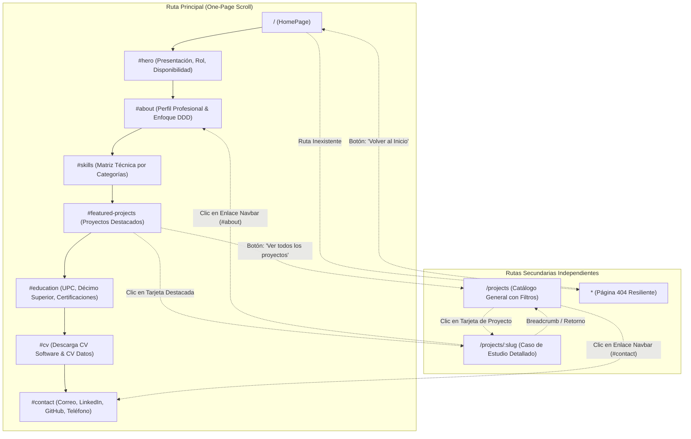

# Mapa de Navegación y Flujos de Usuario

**Documento:** DESIGN-NAV-001  
**Versión:** 1.0.0  
**Fecha:** 15 de noviembre de 2026  
**Autor:** Senior UI/UX Designer & Frontend Architect  

---

## 1. Topología del Mapa de Navegación Híbrida

El sitio combina la navegación vertical fluida de una página principal estructurada con la profundidad de rutas dedicadas para la exploración de proyectos:

---

## 2. Flujos Clave de Usuario (User Journeys)

### Flujo 1: Reclutador Técnico en Búsqueda Rápida de Candidato (30 segundos)
1. **Entrada:** Aterriza en `/` desde un enlace en LinkedIn o CV.
2. **Hero:** Lee en 3 segundos: *"Ricardo Cardenas — Estudiante de Ingeniería de Software (8.º Ciclo, Décimo Superior) en UPC | Especializado en Backend, Arquitectura DDD y Cloud"*.
3. **Disponibilidad:** Observa el badge *"Disponible para prácticas preprofesionales"*.
4. **Acción directa:** Hace clic en el botón principal *"Descargar CV"*.
5. **Selección:** Elige *"CV Software Engineering / Backend"* en el menú emergente. Se descarga el PDF oficial verificado.
6. **Resultado:** Candidato preseleccionado sin fricción.

### Flujo 2: Lead Architect Evaluando Calidad Técnica y Arquitectura (5 minutos)
1. **Entrada:** Aterriza en `/` y hace clic en *"Proyectos"* en la barra superior.
2. **Smooth scroll:** La página se desplaza suavemente a `#featured-projects`.
3. **Selección:** Observa el proyecto *Nexo — Agentic GraphRAG* con tags `FastAPI`, `LangGraph`, `PostgreSQL/pgvector`, `Neo4j` y `DDD`.
4. **Profundización:** Hace clic en *"Ver caso de estudio"* y navega a `/projects/nexo-agentic-graphrag`.
5. **Inspección:** Examina la arquitectura del monolito modular, la justificación de DDD/CQRS, las decisiones de aislamiento multiorganización y los comandos de prueba verificados.
6. **Código fuente:** Hace clic en *"Ver Repositorio GitHub"* (`target="_blank"`).
7. **Retorno:** Hace clic en el breadcrumb *"Proyectos"* para explorar otro caso de estudio (*Capital Cruise* o *TaleStar Mobile*).

### Flujo 3: Hiring Manager de Datos e Inteligencia Artificial (2 minutos)
1. **Entrada:** Aterriza en `/projects`.
2. **Filtrado:** Hace clic en la pestaña *"Data & AI"*.
3. **Resultados inmediatos:** El catálogo filtra la lista y muestra *TheLook eCommerce Data Pipeline*, *Customer Churn Analytics* y *Nexo*.
4. **Detalle:** Abre *TheLook eCommerce*, revisa la arquitectura de BigQuery, el uso de BigQuery ML (Logistic Regression, ARIMA_PLUS) y el volumen procesado (2.4M eventos).
5. **Contacto:** Hace clic en *"Contacto"* en el header; el enrutador navega a `/#contact` y enfoca el botón *"Copiar correo"*.

---

## 3. Comportamiento de Scroll y Breadcrumbs

- **Scroll Restoral:** Al navegar a una nueva ruta secundaria (`/projects/:slug`), la ventana se posiciona automáticamente en `top: 0`.
- **Breadcrumbs Semánticos:**
  - En `/projects`: `Inicio / Proyectos`
  - En `/projects/:slug`: `Inicio / Proyectos / [Nombre del Proyecto]`
- **Preservación de Parámetros de Filtro:** Si el usuario filtra por `Data & AI` y luego entra a un detalle, al volver atrás con el navegador se mantiene seleccionada la pestaña activa.
