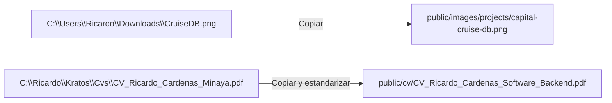

# Inventario de Recursos Visuales y Activos de Diseño

**Documento:** ASSETS-INV-001  
**Versión:** 2.0.0 (Actualizada con políticas estrictas de privacidad personal y académica)  
**Fecha:** 16 de noviembre de 2026  
**Proyecto:** Portafolio Profesional de Ricardo Fernando Cardenas Minaya  
**Fase:** Fase 2C.1 — Auditoría de Fidelidad Visual  
**Estado:** 📋 READY FOR DESIGN APPROVAL  
**Auditor:** Technical Documentation & Visual Assets Engineer  

---

## 1. Resumen y Principios de Privacidad de Activos

El presente inventario clasifica de forma rigurosa todos los recursos visuales, gráficos, capturas de pantalla, diagramas y documentos del entorno de desarrollo.

En atención a las directrices explícitas del usuario, la gestión de activos se rige por tres principios inmutables:
1. **Privacidad Personal:** Queda terminantemente prohibido incorporar fotografías personales, retratos familiares o imágenes sintéticas con apariencia humana al portafolio. Se utiliza exclusivamente el símbolo gráfico oficial de identidad profesional de marca (`public/images/brand/logo.png`).
2. **Privacidad Académica:** Queda terminantemente prohibido publicar promedios de calificaciones, notas individuales, historiales académicos o constancias de notas. Se permite únicamente la mención institucional consolidada de la carrera, ciclo y la distinción de **Décimo Superior / Top 10%**.
3. **Confidencialidad de Tesis (Nexo):** Se mantiene el código fuente, la infraestructura interna y los datos privados de la tesis en UPC completamente protegidos y fuera del alcance público.

---

## 2. Inventario Detallado de Recursos

### 2.1. Recursos Existentes e Integrados en el Proyecto (`/public` y `/docs`)

Recursos que ya forman parte del repositorio del portafolio y cumplen con todas las directrices de privacidad y verosimilitud:

| Archivo / Recurso | Tipo | Ubicación Local | Descripción y Caso de Uso | Estado |
| :--- | :---: | :--- | :--- | :---: |
| `talestar-ar.png` | Imagen (PNG) | `public/images/projects/talestar-ar.png` | Captura real de proyección en Realidad Aumentada con Google ARCore sobre plano físico real. Utilizada en la galería de TaleStar. | ✅ Integrado |
| `talestar-home.png` | Imagen (PNG) | `public/images/projects/talestar-home.png` | Interfaz principal de lectura ilustrada y catálogo infantil de cuentos en Flutter. | ✅ Integrado |
| `talestar-container.png` | Diagrama (PNG) | `public/images/projects/talestar-container.png` | Diagrama C4 de Contenedores de TaleStar Mobile (Flutter, Shaders, Local Storage). | ✅ Integrado |
| `thelook-dashboard.png` | Imagen (PNG) | `public/images/projects/thelook-dashboard.png` | Dashboard ejecutivo en Looker Studio con métricas de 2.4M eventos, ventas y cohortes. | ✅ Integrado |
| `thelook-diagram-er.png` | Diagrama (PNG) | `public/images/projects/thelook-diagram-er.png` | Diagrama de Modelo Relacional canónico en BigQuery (tablas de hechos y dimensiones). | ✅ Integrado |
| `churn-dashboard.png` | Imagen (PNG) | `public/images/projects/churn-dashboard.png` | Dashboard de Business Intelligence en Power BI con segmentación K-Means y análisis DAX. | ✅ Integrado |
| `logo.png` / `logo.webp` | Imagen (PNG/WebP) | `public/images/brand/logo.png` | Logotipo y símbolo gráfico oficial de identidad profesional de marca (512×512 px) y variantes (192, 96, 48, favicons). | ✅ Integrado |
| Capturas E2E (20 archivos) | Imagen (PNG) | `docs/reports/screenshots/*.png` | Capturas automatizadas de alta resolución (Light/Dark, 1440px, 768px, 390px) del catálogo, home y detalles. | ✅ Integrado |

---

### 2.2. Recursos Disponibles en el Entorno Local Autorizados para Uso

Recursos no personales auditados físicamente en las unidades del desarrollador, cuya integración aporta valor técnico sin vulnerar la privacidad:

| Archivo / Recurso | Dimensión / Tamaño | Ubicación Origen | Utilidad y Propuesta de Incorporación | Verificación |
| :--- | :---: | :--- | :--- | :---: |
| `CruiseDB.png` | 254.7 KB (PNG) | `C:\Users\Ricardo\Downloads\CruiseDB.png` | **Diagrama de Base de Datos Relacional de Capital Cruise** (dbdiagram.io) con entidades de créditos, cronogramas, clientes y vehículos. Ideal para la galería del caso de estudio. | Verificado |
| `CV_Ricardo_Cardenas_Minaya.pdf` | 197.0 KB (PDF) | `C:\Ricardo\Kratos\Cvs\CV_Ricardo_Cardenas_Minaya.pdf` | **Currículum Vitae oficial actualizado** (15/11/2026). Listo para copiar a `public/cv/` para la descarga directa en la Home y Navbar. | Verificado |
| `Ricardo_Fernando_Cardenas_MinayaSoftwareATSNuevo.docx` | 27.7 KB (DOCX) | `C:\Ricardo\Kratos\Cvs\Ricardo_Fernando_Cardenas_MinayaSoftwareATSNuevo.docx` | Versión estructurada ATS para perfiles de Software Engineering & Backend. | Verificado |
| `payment-mobile.png` | 28.1 KB (PNG) | `C:\Users\Ricardo\Downloads\payment-mobile.png` | Interfaz móvil de configuración y pasarela de facturación (TaleStar/Mecanaut). | Verificado |
| `signin-mobile.png` | 22.4 KB (PNG) | `C:\Users\Ricardo\Downloads\signin-mobile.png` | Pantalla de inicio de sesión móvil en Flutter con validaciones. | Verificado |

---

### 2.3. Recursos Estrictamente Excluidos por Privacidad Personal y Académica

Por instrucción explícita del usuario, los siguientes recursos identificados en el entorno local **NO se copiarán, NO se publicarán y NO se mostrarán bajo ninguna circunstancia en el portafolio**:

| Recurso Excluido | Ubicación Origen | Motivo de Exclusión Estricta | Acción Preventiva |
| :--- | :--- | :--- | :--- |
| `Ricardo.png` | `C:\Users\Ricardo\Downloads\Ricardo.png` | **Fotografía personal del desarrollador.** El usuario decidió no divulgar su imagen física. | **EXCLUIDO.** No se copiará al proyecto ni se referenciará en ningún componente. El Hero conservará el monograma RC. |
| `Yo.png` | `C:\Users\Ricardo\Downloads\Yo.png` | **Fotografía personal del desarrollador.** | **EXCLUIDO.** No se copiará ni utilizará. |
| `Orden Merito - Ricardo Cardenas.png` | `C:\Users\Ricardo\Downloads\Orden Merito - Ricardo Cardenas.png` | **Historial oficial de notas y calificaciones universitarias.** Contiene datos académicos confidenciales. | **EXCLUIDO.** No se copiará ni se creará ningún modal para visualizarlo. |
| Promedio Ponderado Numérico Privado | Historial académico de notas | **Dato académico privado.** | **EXCLUIDO.** Eliminado de cualquier texto o métrica del portafolio. Se conserva únicamente el reconocimiento de Décimo Superior / Top 10%. |
| Constancias académicas y notas | `C:\Users\Ricardo\Downloads\*` | **Documentos privados de evaluación.** | **EXCLUIDO.** Cero publicación o enlaces a documentos de calificaciones. |

> [!NOTE]
> Los archivos originales permanecen intactos en las carpetas personales del usuario (`Downloads`, `Cvs`); la política consiste estrictamente en no incorporarlos al repositorio del portafolio.

---

### 2.4. Recursos Faltantes o Pendientes de Provisión

| Recurso Faltante | Ubicación Esperada | Diagnóstico y Acción |
| :--- | :--- | :--- |
| `approved-portfolio-reference.png` | `docs/design/references/approved-portfolio-reference.png` | **NO EXISTE EN DISCO.** Se confirmó la ausencia del archivo. Se deja creada la carpeta contenedora. La auditoría y el diseño se sustentan en las especificaciones aprobadas en Markdown (`docs/design/mockups/`). |
| Captura Swagger/OpenAPI de `Jobsy-Backend` | `public/images/projects/jobsy-swagger.png` | No existe en disco. Opcional: Generar captura local ejecutando `dotnet run` o diseñar un bloque esquemático de endpoints en código. |
| Captura de Consola IoT de `MediTrack` | `public/images/projects/meditrack-iot.png` | No existe en disco. Opcional: Utilizar diagrama conceptual de arquitectura distribuida Edge-Fog-Cloud. |

---

### 2.5. Recursos Confidenciales de Tesis (Nexo — Agentic GraphRAG)

| Recurso Sensible | Ubicación Física | Naturaleza | Política de Exposición en el Portafolio |
| :--- | :--- | :--- | :--- |
| Código Fuente de Backend (`backend/app/*`) | `C:\Ricardo\ProyectoTesis\Nexo\backend` | Código propietario de tesis | **ESTRICTAMENTE PROHIBIDO.** Cero commits, cero enlaces a repositorios y cero fragmentos de código fuente sin anonimizar. |
| Tareas y Workers de Celery (`worker/*`) | `C:\Ricardo\ProyectoTesis\Nexo\worker` | Algoritmos de ingesta y orquestación | **ESTRICTAMENTE PROHIBIDO.** No se divulgan pipelines de ingesta internos. |
| Credenciales y Secretos (`.env`, `.env.docker`) | `C:\Ricardo\ProyectoTesis\Nexo\.env*` | Claves JWT, contraseñas de PostgreSQL y Neo4j | **ESTRICTAMENTE PROHIBIDO.** Cero inclusión de credenciales o URLs de infraestructura interna. |
| Archivos de Base de Datos (`data/*`) | `C:\Ricardo\ProyectoTesis\Nexo\data` | Volúmenes locales de PostgreSQL y Neo4j | **ESTRICTAMENTE PROHIBIDO.** No se incluyen datos de prueba comerciales o académicos. |
| Topología de Arquitectura de Alto Nivel | Componente React `ArchitectureDiagram` | Modelo conceptual DDD y componentes | **PERMITIDO.** Se muestra exclusivamente la topología de bloques abstracta (FastAPI, Postgres, Neo4j, Celery) destacando LangGraph como *Planificado*. |
| Métricas Cuantitativas Auditadas | Componente React `MetricsBanner` | Conteo de Bounded Contexts y paso de Pytest | **PERMITIDO.** Información pública y auditable de ingeniería sin secretos comerciales. |

---

## 3. Plan de Integración de Recursos Autorizados para Fase 2C.2

Cuando el usuario otorgue su aprobación formal, se procederá exclusivamente con la integración de los siguientes activos no personales autorizados:

1. **Diagrama de Base de Datos de Capital Cruise (`public/images/projects/capital-cruise-db.png`):**
   - Incorporar `CruiseDB.png` a la galería técnica del caso de estudio de Capital Cruise.
2. **PDF de Currículum Oficial (`public/cv/CV_Ricardo_Cardenas_Software_Backend.pdf`):**
   - Publicar el documento oficial para habilitar la descarga real y funcional en la Home y Navbar.
3. **Recurso Gráfico Abstracto Técnico para el Hero:**
   - Diseñar en código React/Tailwind un componente visual no personal (matriz de componentes modulares con Bounded Contexts, indicadores luminosos de estado y topología abstracta) para la columna derecha del Hero.

---

> [!IMPORTANT]
> **ESTADO DEL INVENTARIO: AUDITADO Y ACTUALIZADO**  
> Todos los recursos personales y calificaciones privadas han sido formalmente excluidos. Los activos técnicos autorizados quedan inventariados para su uso seguro en la Fase 2C.2.
