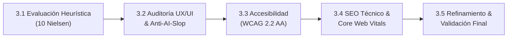

# Plan de Trabajo Detallado — FASE 3: Auditoría Integral de UX/UI, Usabilidad, Accesibilidad y Optimización

**Documento:** PLAN-FASE-3-AUDIT-001  
**Versión:** 1.0.0  
**Fecha:** 16 de noviembre de 2026  
**Proyecto:** Portafolio Profesional de Ricardo Fernando Cardenas Minaya  
**Estado:** 📋 **PLANIFICADO (A la espera de aprobación formal de la Fase 2C.4)**  
**Commit base previsto:** `bb7793a` (o commit de cierre de Fase 2C.4)  
**Autor:** Antigravity Engineering & Design Systems Team  

---

## 1. Visión General y Objetivos de la Fase 3

La **Fase 3** trasciende una optimización meramente técnica de SEO y Lighthouse. Constituye una **auditoría integral y rigurosa de ingeniería de interfaces, experiencia de usuario (UX), diseño visual (UI), accesibilidad universal (WCAG 2.2 AA) y rendimiento de producción**.

El objetivo central es someter la aplicación React implementada a estándares rigurosos de usabilidad y accesibilidad, depurar fricciones cognitivas o visuales, asegurar que cada interacción sea predecible y fluida bajo la dirección de diseño **Minimalista Profesional (B)**, y dejar la plataforma lista para su despliegue en la Fase 4.

> [!IMPORTANT]
> **Condición de Inicio:** La ejecución de las tareas contenidas en este plan **NO comenzará** hasta que la Fase 2C.4 haya sido formalmente culminada, verificada y aprobada por el usuario.

---

## 2. Skills Instaladas y Metodología de Ejecución

Se emplearán exclusivamente las habilidades de ingeniería y diseño realmente instaladas y verificadas en el entorno:

| Skill / Herramienta | Rol en la Fase 3 |
| :--- | :--- |
| **`emil-design-eng`** | Evaluación y pulido de microinteracciones, transiciones físicas (`active:scale-[0.98]`), refinamiento visual de bordes, superficies y eliminación de saltos bruscos. |
| **`web-design-guidelines`** | Auditoría visual de interfaz web contra mejores prácticas modernas de diseño, legibilidad, affordances y coherencia editorial. |
| **`break-ui`** | Pruebas de estrés de interfaz mediante inyección de cadenas extremas, visualización en viewports atípicos, y zoom al 200%. |
| **`playwright-cli`** | Automatización de pruebas E2E, auditorías de accesibilidad con `@axe-core/playwright`, snapshots visuales de regresión y emulación multidispositivo. |
| **`testing-strategy`** | Definición de suites de regresión, matrices de calidad y criterios de severidad para el backlog de hallazgos. |
| **`frontend-development`** | Refinamiento de componentes React 19, optimización de renderizados, memoización y gestión limpia del estado. |
| **Superpowers (`systematic-debugging`, `executing-plans`, `verification-before-completion`)** | Aislamiento metódico de causas raíz en defectos detectados, ejecución disciplinada de cambios y verificación con evidencia antes de declarar tareas resueltas. |

---

## 3. Bloques Obligatorios de Trabajo

---

### Bloque 3.1: Evaluación Heurística de Usabilidad (10 Heurísticas de Nielsen)

Se inspeccionarán metódicamente las 3 rutas principales (`/`, `/projects`, `/projects/:slug`) y la ruta de error (`/404`), evaluando cada pantalla contra las 10 heurísticas de Jakob Nielsen:

1. **H1 — Visibilidad del estado del sistema:**
   - Feedback inmediato en toggles de tema (claro/oscuro) e idioma (ES/EN).
   - Indicador visual al copiar el correo al portapapeles ("¡Copiado!").
   - Conteo dinámico de proyectos visibles tras aplicar filtros o búsquedas.
   - Estado de scroll y sección activa en el menú de navegación.
2. **H2 — Coincidencia entre el sistema y el mundo real:**
   - Terminología de ingeniería de software estándar (DDD, Bounded Contexts, CQRS, DAX).
   - Lenguaje claro y adaptado a reclutadores técnicos y arquitectos de software sin jerga confusa innecesaria.
3. **H3 — Control y libertad del usuario:**
   - Cierre del lightbox de capturas con la tecla `Escape`, botón visible o clic exterior.
   - Navegación bidireccional entre imágenes con flechas del teclado.
   - Botón directo para limpiar filtros de búsqueda y restablecer el catálogo.
   - Enlace claro y visible de retorno al catálogo desde cualquier estudio de caso.
4. **H4 — Consistencia y estándares:**
   - Uniformidad en la paleta violeta (`#7C3AED` / `#8B5CF6`) y fondos neutros (`#09090B` / `#FFFFFF`).
   - Radio de esquinas consistente (`rounded-xl` en tarjetas, `rounded-2xl` en contenedores mayores).
   - Tipografía Inter uniforme con jerarquía Display, H1, H2, H3, Body y Monoespaciado.
5. **H5 — Prevención de errores:**
   - Búsqueda tolerante a mayúsculas y minúsculas sin lanzar errores ante términos inexistentes.
   - Página 404 personalizada con enlace semántico de retorno al Inicio ante URLs mal escritas.
   - Enlaces externos con `rel="noopener noreferrer"` y validación de atributos.
6. **H6 — Reconocimiento antes que recuerdo:**
   - Breadcrumbs semánticos completos en catálogo y detalles (`Inicio / Catálogo / Proyecto`).
   - Etiquetas visibles y permanentes en campos de entrada y filtros.
   - Indicadores de rol personal e insignia de código privado en tarjetas y fichas.
7. **H7 — Flexibilidad y eficiencia de uso:**
   - Navegación rápida por teclado (atajos de salto, tabs, Escape).
   - Búsqueda reactiva instantánea que filtra por título, resumen, rol y tecnología.
   - Acceso rápido a descarga de CV desde la cabecera (Hero) y desde la sección dedicada.
8. **H8 — Diseño estético y minimalista:**
   - Ausencia de decoraciones gratuitas, fondos sobrecargados o sombras desmesuradas.
   - Composición editorial de dos columnas que maximiza la legibilidad y el escaneo visual.
   - Separación estricta de espacios en blanco (`py-12`, `gap-6`, `space-y-8`).
9. **H9 — Ayuda para reconocer, diagnosticar y recuperarse de errores:**
   - Estado vacío descriptivo (`EmptyState`) cuando una búsqueda no arroja resultados, con botón explícito de reinicio.
   - Mensajes de error amigables sin exponer stack traces ni detalles técnicos internos.
10. **H10 — Ayuda y documentación:**
    - Tooltips contextuales en fuentes verificadas de métricas y tecnologías secundarias.
    - Captions descriptivos en imágenes de galería.
    - Avisos explícitos de confidencialidad y reserva de investigación de tesis.

#### Escala de Severidad de Hallazgos
- **Severidad 0:** No constituye un problema de usabilidad.
- **Severidad 1:** Defecto cosmético menor (no interfiere en el flujo de usuario).
- **Severidad 2:** Problema de usabilidad menor (baja prioridad de corrección).
- **Severidad 3:** Problema de usabilidad mayor (dificulta la interacción; debe corregirse antes de desplegar).
- **Severidad 4:** Catástrofe de usabilidad / bloqueante (impide completar una tarea esencial).

---

### Bloque 3.2: Auditoría UX/UI & Detección Anti-AI-Slop

1. **Arquitectura de Información y Carga Cognitiva:**
   - Evaluar si el orden de secciones en la Home (Hero → About → Skills → Proyectos → Educación/Certificaciones → CV → Contacto) favorece la comprensión progresiva del perfil.
   - Comprobar que la cantidad de información visible por pantalla no abrume al evaluador técnico (ley de Miller: agrupaciones de 5 a 7 elementos).
2. **Detección Anti-AI-Slop (Erradicación de Patrones Genéricos):**
   - Verificar que ningún texto contenga clichés vacíos comunes en sitios generados por IA (ej. "ingeniero apasionado por crear soluciones disruptivas de vanguardia").
   - Comprobar que todas las métricas expuestas cuenten con una fuente técnica trazable (dataset, commit, pruebas automatizadas).
   - Asegurar que no existan mockups de teléfonos o navegadores falsos para proyectos que no cuentan con interfaz visual real; uso estricto de fichas de arquitectura editorial tipográfica.
3. **Affordances y Microinteracciones (`emil-design-eng`):**
   - Respuesta visual táctil al hacer clic en botones y tarjetas (`active:scale-[0.98]`).
   - Estados de foco bien diferenciados con anillo perimetral violeta (`focus-visible:ring-2 focus-visible:ring-primary`).
   - Transiciones suaves de opacidad y escala (150ms a 200ms) sin animaciones lentas o mareantes.
4. **Ergonomía y Usabilidad Móvil:**
   - Áreas de toque mínimas de 44x44px en controles interactivos (botones, toggles, enlaces de navegación).
   - Ausencia de "sticky hovers" en dispositivos táctiles (estados hover que quedan bloqueados al tocar).
   - Menú móvil deslizante (`MobileNavSheet`) con cierre automático al seleccionar una sección.

---

### Bloque 3.3: Accesibilidad Universal (WCAG 2.2 Nivel AA)

Se auditará la conformidad técnica mediante comprobaciones automatizadas y revisión manual exhaustiva:

1. **Comprobaciones Automatizadas:**
   - Integración y ejecución de `@axe-core/playwright` en todas las rutas bajo modo claro y oscuro.
   - Detección de cero violaciones críticas o serias en roles, contraste y atributos ARIA.
2. **Navegación por Teclado y Gestión del Foco:**
   - Navegación secuencial lógica (`Tab` / `Shift+Tab`) por todos los elementos interactivos sin bloqueos.
   - Indicador de foco visible con contraste adecuado sobre fondos claros y oscuros.
   - Trampa de foco (Focus Trap) activa en diálogos modales (`ProjectGallery` y `MobileNavSheet`).
   - Restauración obligatoria del foco al elemento desencadenante al cerrar modales con la tecla `Escape`.
3. **Contraste de Color:**
   - Contraste mínimo de texto normal $\ge 4.5:1$ sobre su superficie.
   - Contraste de texto grande ($\ge 18\text{pt}$ o $\ge 14\text{pt}$ negrita) y componentes UI $\ge 3.0:1$.
   - Verificación de contraste en etiquetas secundarias, bordes y texto atenuado (`text-text-muted`).
4. **Adaptabilidad y Reflow:**
   - Zoom del navegador al 200% sin pérdida de contenido, truncamiento ilegible ni superposición de elementos.
   - Soporte para viewport ultra-compacto de 320px de ancho sin scroll horizontal (`overflow-x: hidden` verificado = 0px).
5. **Lectores de Pantalla y Semántica:**
   - Estructura jerárquica de encabezados estricta: un solo `h1` por vista, seguido de `h2`, `h3` sin saltos de nivel.
   - Textos alternativos (`alt`) descriptivos en capturas reales y `aria-label` en iconos funcionales.
   - Etiquetas bilingües en elementos ARIA (`aria-modal`, `aria-expanded`, `aria-label`).
6. **Preferencia de Movimiento Reducido:**
   - Soporte para `@media (prefers-reduced-motion: reduce)` desactivando animaciones de traslación o pulsos que puedan causar malestar vestibular.

---

### Bloque 3.4: SEO Técnico, Metadatos y Core Web Vitals

1. **Core Web Vitals y Rendimiento:**
   - **Largest Contentful Paint (LCP):** $\le 2.5\text{ segundos}$.
   - **Interaction to Next Paint (INP):** $\le 200\text{ milisegundos}$.
   - **Cumulative Layout Shift (CLS):** $\le 0.1$ (sin movimientos inesperados durante la carga de fuentes o imágenes).
2. **Optimización de Activos e Imágenes:**
   - Auditoría de peso de capturas en `public/images/projects/`.
   - Implementación de atributos `loading="lazy"` y `decoding="async"`.
   - Dimensiones explícitas (`aspect-ratio`) en contenedores para prevenir CLS.
   - Optimización de fuentes tipográficas (Inter) con `font-display: swap` y scripts de prevención de FOUT inline.
3. **Metadatos por Proyecto y Open Graph:**
   - Configuración de títulos y descripciones semánticas por ruta mediante metadatos HTML o `react-helmet-async`.
   - Tarjetas Open Graph (`og:title`, `og:description`, `og:image`, `og:type`) y Twitter Cards (`twitter:card`).
   - Enlaces canónicos para evitar duplicidad de contenido.
4. **Indexabilidad y Rastreo:**
   - Generación de `public/sitemap.xml` con todas las rutas públicas (`/`, `/projects`, `/projects/:slug`).
   - Generación de `public/robots.txt` autorizando el rastreo y apuntando al sitemap.
   - Estrategia de prerenderizado para que motores de búsqueda indexen el contenido sin depender exclusivamente de la ejecución de JavaScript en cliente.

---

### Bloque 3.5: Refinamiento, Validación y Protocolo de Pruebas con Usuarios

1. **Backlog Priorizado de Corrección:**
   - Clasificación de defectos descubiertos en las auditorías previas mediante matriz Impacto vs. Esfuerzo.
   - Resolución obligatoria de todos los ítems de Severidad 3 y 4.
2. **Pruebas de Regresión Automatizadas:**
   - Ejecución de la suite completa de Vitest (35+ pruebas) y Playwright E2E (38+ pruebas).
   - Confirmación de cero regresiones funcionales en cambios de idioma, tema, filtros o descargas de CV.
3. **Evidencias Visuales Comparativas:**
   - Generación de capturas de alta resolución antes/después para cada ajuste realizado.
4. **Protocolo de Pruebas de Usabilidad con Participantes Reales:**
   - **Diseño del Experimento:** Tareas guiadas representativas de un reclutador o evaluador técnico:
     - *Tarea 1:* Localizar el caso de estudio de Capital Cruise y verificar el enlace a su repositorio en GitHub.
     - *Tarea 2:* Filtrar proyectos de Data & AI y encontrar la métrica de eventos procesados en BigQuery.
     - *Tarea 3:* Descargar el currículum vitae especializado en Backend.
     - *Tarea 4:* Cambiar el idioma a inglés y alternar entre temas claro y oscuro.
     - *Tarea 5:* Navegar a través de la galería de capturas de TaleStar usando únicamente el teclado.
   - **Métricas:** Tasa de éxito de la tarea (Task Success Rate), tiempo por tarea (Time-on-Task) y escala System Usability Scale (SUS).
   - **Regla Ética Estricta:** No se afirmará ni documentará validación con usuarios a menos que la sesión haya sido ejecutada efectivamente con participantes reales. De no contarse con participantes externos en el plazo, se documentará honestamente como *Protocolo Diseñado — Pendiente de Ejecución con Cohorte Externa*.

---

## 4. Matriz de Entregables de la Fase 3

| # | Entregable | Archivo de Destino | Descripción |
| :-: | :--- | :--- | :--- |
| **1** | **Matriz de Evaluación Heurística** | `docs/quality/heuristic-evaluation-matrix.md` | Tabla detallada con las 10 heurísticas evaluadas en las 4 rutas, hallazgos, severidad (0-4), capturas de evidencia y solución recomendada. |
| **2** | **Informe de Auditoría UX/UI** | `docs/quality/ux-ui-audit-report.md` | Diagnóstico de arquitectura de información, consistencia con el Design System (B), ergonomía móvil, affordances y auditoría Anti-AI-Slop. |
| **3** | **Checklist WCAG 2.2 AA** | `docs/quality/wcag-accessibility-checklist.md` | Criterio por criterio de WCAG 2.2 AA, verificando conformidad con pruebas automáticas (`axe-core`) y comprobación manual de teclado y lectores de pantalla. |
| **4** | **Informe de Rendimiento y SEO** | `docs/quality/performance-and-seo-report.md` | Reportes de Lighthouse, métricas Core Web Vitals (LCP, INP, CLS), auditoría de assets, metadatos Open Graph y sitemap. |
| **5** | **Backlog de Problemas Priorizados** | `docs/planning/phase-3-backlog.md` | Lista priorizada de incidencias (P0 a P3) con responsable, estado y trazabilidad hacia el código fuente. |
| **6** | **Evidencias de Corrección** | `docs/reports/screenshots/phase-3/` | Carpeta con capturas comparativas (antes / después) para cada ajuste aplicado durante el refinamiento. |
| **7** | **Informe Consolidado de Validación** | `docs/reports/phase-3-completion-report.md` | Informe final de cierre de la Fase 3 con Quality Gates ejecutados, resultados de pruebas y estado de preparación para la Fase 4. |

---

## 5. Criterios de Aceptación del Quality Gate de Fase 3

Para declarar la Fase 3 completada y autorizar el paso a la Fase 4 (Despliegue), deberán cumplirse el 100% de los siguientes criterios:

- [ ] Cero errores de compilación en TypeScript (`npm run typecheck` con exit code 0).
- [ ] Cero errores y advertencias de linter (`npm run lint` con exit code 0).
- [ ] 100% de pruebas unitarias aprobadas en Vitest (`npm run test`).
- [ ] 100% de pruebas E2E aprobadas en Playwright en escritorio y móvil.
- [ ] Puntuaciones mínimas en Google Lighthouse en producción:
  - **Performance:** $\ge 90$
  - **Accessibility:** $\ge 95$
  - **Best Practices:** $\ge 95$
  - **SEO:** $\ge 95$
- [ ] Cero violaciones críticas o serias en auditoría automatizada con `@axe-core/playwright`.
- [ ] Verificación manual de navegación por teclado sin trampas ni pérdida de foco.
- [ ] Ausencia de scroll horizontal en viewports de 320px a 1440px (overflow = 0px).
- [ ] Archivos `sitemap.xml` y `robots.txt` presentes y validados sintácticamente.
- [ ] Ambas opciones de CV verificadas para descarga directa sin errores 404 ni enlaces rotos.
- [ ] Preservación estricta de la privacidad de la tesis Nexo (cero código o enlaces expuestos).
