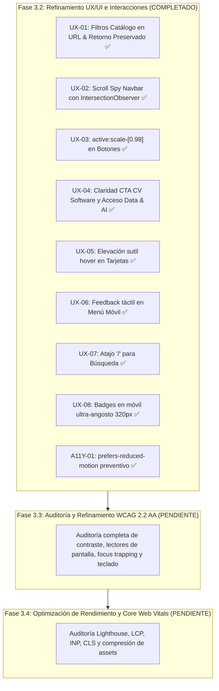

# Backlog Priorizado de Mejoras — FASE 3
## Usabilidad, Experiencia de Usuario y Refinamiento de Interfaces

**Documento:** BACKLOG-FASE-3-001  
**Versión:** 1.0.0  
**Fecha:** 16 de noviembre de 2026  
**Origen:** Derivado de la Auditoría Heurística (Fase 3.1), Recorridos de Usuario y Revisión UX/UI  
**Estado:** ✅ **FASE 3.2 IMPLEMENTADA Y VERIFICADA (9/9 tareas completadas: 8 UX + 1 A11Y)**  

> [!NOTE]
> **Conciliación de alcance (9 tareas de Fase 3.1):** La Fase 3.1 registró 9 tareas discretas (8 con prefijo UX: UX-01 a UX-08, más 1 de accesibilidad: A11Y-01). En el resumen narrativo inicial de Fase 3.2, UX-03, UX-05 y UX-06 se agruparon temáticamente bajo 'Microinteracciones físicas y táctiles', originando 8 secciones temáticas. Las 9 tareas individuales están plenamente implementadas y verificadas con pruebas automatizadas.

---

## 1. Criterios de Clasificación y Priorización

El backlog consolida todos los hallazgos técnicos y de diseño obtenidos en la Fase 3.1, categorizados por nivel de impacto y momento oportuno de implementación:

| Prioridad | Nivel de Severidad | Criterio de Ejecución |
| :---: | :---: | :--- |
| **P0 — Crítica** | Severidad 4 | **Bloqueante.** Impide completar un flujo esencial. Requiere corrección inmediata antes de cualquier avance. *(Total detectados: 0)* |
| **P1 — Alta** | Severidad 2 - 3 | **Antes del Despliegue.** Mejora sustancial de usabilidad o accesibilidad obligatoria antes de publicar en producción (Fase 3.2 / 3.3 / 3.5). |
| **P2 — Media** | Severidad 1 - 2 | **Pulido Fino (Fase 3.2 / v1.1).** Refinamiento visual, microinteracciones `emil-design-eng` y ergonomía de interacción. |
| **P3 — Baja** | Severidad 1 | **Deseable / Post-Lanzamiento.** Atajos avanzados y optimizaciones para casos extremos. |

---

## 2. Matriz General de Tareas del Backlog

| ID | Prioridad | Severidad | Módulo / Componente | Título de la Tarea | Estado | Fase / Verificación |
| :---: | :---: | :---: | :--- | :--- | :---: | :---: |
| **UX-01** | **P1 (Alta)** | 2 | `ProjectsCatalogPage.tsx` | Sincronización bidireccional de filtros de catálogo con URL Search Params (`?category=...&q=...`) y retorno con estado | ✅ **Completado** | Fase 3.2 (`ProjectsCatalogPage.test.tsx`, E2E test) |
| **UX-02** | **P1 (Alta)** | 2 | `Navbar.tsx` & `useScrollSpy.ts` | Implementación de Scroll Spy en la barra de navegación superior con `IntersectionObserver` | ✅ **Completado** | Fase 3.2 (`useScrollSpy.test.ts`, E2E test) |
| **A11Y-01** | **P1 (Alta)** | 2 | `Button.tsx`, `HeroArchitectureGraphic.tsx`, `Card.tsx` | Respeto riguroso de `prefers-reduced-motion` en microanimaciones y escalados interactivos | ✅ **Completado** | Fase 3.2 (Playwright E2E emulación reducida) |
| **UX-03** | **P2 (Media)** | 1 | `Button.tsx` & Disparadores | Estandarización de microinteracciones físicas táctiles (`active:scale-[0.98]`) según `emil-design-eng` | ✅ **Completado** | Fase 3.2 (Estilos base en `buttonVariants`) |
| **UX-04** | **P2 (Media)** | 1 | `HeroSection.tsx` | Clarificación del CTA de descarga de CV en el Hero ("Descargar CV Software (PDF)") y enlace contextual a Data & AI | ✅ **Completado** | Fase 3.2 (E2E verificado en ES y EN) |
| **UX-05** | **P2 (Media)** | 1 | `FeaturedProjectCard.tsx` & `ProjectsCatalogPage.tsx` | Elevación sutil en hover (`hover:-translate-y-0.5`) con transición de propiedades discretas | ✅ **Completado** | Fase 3.2 (Transiciones CSS discretas) |
| **UX-06** | **P2 (Media)** | 1 | `MobileNavSheet.tsx` | Respuesta táctil visual inmediata al tocar enlaces en dispositivos móviles (`active:bg-surface-muted/80`) | ✅ **Completado** | Fase 3.2 (Verificado en mobile viewports) |
| **UX-07** | **P3 (Baja)** | 1 | `ProjectsCatalogPage.tsx` | Atajo de teclado global (`/`) para enfocar instantáneamente el campo de búsqueda | ✅ **Completado** | Fase 3.2 (`ProjectsCatalogPage.test.tsx`, E2E test) |
| **UX-08** | **P3 (Baja)** | 1 | `HeroSection.tsx` | Optimización de espaciado vertical (`gap-2 sm:gap-2.5`, `text-[11px] sm:text-xs`) para badges en <360px | ✅ **Completado** | Fase 3.2 (Verificado en viewport 320px) |

---

## 3. Especificación Técnica de Tareas Prioritarias

---

### [UX-01] Sincronización de Filtros y Búsqueda del Catálogo con la URL
- **Prioridad:** **P1 (Alta — Antes del Despliegue)**
- **Severidad:** 2 (Menor en usabilidad, pero impacto notable en navegación repetitiva).
- **Origen:** Hallazgo H3-01 (Auditoría Heurística) & Recorrido 3 (User Journeys).
- **Archivos a modificar:** `src/pages/ProjectsCatalogPage.tsx`.
- **Descripción técnica:**
  Reemplazar el estado local `useState` de categoría y búsqueda por el hook `useSearchParams` de React Router.
  - Al cambiar la categoría, actualizar la URL: `/projects?category=data-ai`.
  - Al escribir en el buscador, reflejar el query param con un ligero debounce: `/projects?category=data-ai&q=bigquery`.
  - Al cargar la página, inicializar los filtros desde la URL si existen parámetros válidos.
- **Criterio de Aceptación:**
  1. Si un usuario filtra por `Data & AI`, abre el detalle de un proyecto y presiona el botón "Atrás" del navegador o "Volver al catálogo", la página de catálogo conserva activa la categoría `Data & AI`.
  2. Si un usuario comparte el enlace `/projects?category=software-engineering`, la página se abre mostrando directamente los 4 proyectos de software.

---

### [UX-02] Scroll Spy en Navbar Desktop
- **Prioridad:** **P1 (Alta — Antes del Despliegue)**
- **Severidad:** 2 (Visibilidad del estado del sistema).
- **Origen:** Hallazgo H1-01 (Auditoría Heurística).
- **Archivos a modificar:** `src/components/layout/Navbar.tsx`, creación de hook `src/hooks/useScrollSpy.ts`.
- **Descripción técnica:**
  Crear un hook reutilizable basado en la API nativa del navegador `IntersectionObserver` que detecte la sección visible en el centro del viewport (`threshold: 0.3` o `rootMargin: '-20% 0px -70% 0px'`).
  - Aplicar las clases semánticas `text-primary font-semibold border-b-2 border-primary` al enlace de navegación correspondiente a la sección activa.
- **Criterio de Aceptación:**
  1. Al hacer scroll por la Home, el enlace superior correspondiente a la sección actualmente leída (`Sobre mí`, `Tecnologías`, `Proyectos`, `Formación`, `Currículum`, `Contacto`) se resalta visualmente en color primario con una transición suave.

---

### [A11Y-01] Soporte para `prefers-reduced-motion` en Todos los Gráficos y Microinteracciones
- **Prioridad:** **P1 (Alta — Accesibilidad WCAG 2.2 AA)**
- **Severidad:** 2 (Accesibilidad sensorial para usuarios con trastornos vestibulares).
- **Origen:** Auditoría UX/UI Complementaria (Sección 3).
- **Archivos a modificar:** `src/components/ui/HeroArchitectureGraphic.tsx`, `src/components/projects/ProjectCoverGraphic.tsx`, `src/components/ui/Badge.tsx`.
- **Descripción técnica:**
  Asegurar que todas las clases que aplican transformaciones o animaciones continuas (ej. el pulso verde del badge de disponibilidad o el escalado hover de diagramas) cuenten con las clases `motion-reduce:animate-none` y `motion-reduce:transform-none`.
- **Criterio de Aceptación:**
  1. Con la preferencia de sistema `prefers-reduced-motion: reduce` activada en el navegador o sistema operativo, ninguna animación o transformación se reproduce de forma continua.

---

### [UX-03] Estandarización de Respuesta Táctil Física (`active:scale-[0.98]`)
- **Prioridad:** **P2 (Media — Pulido Fino)**
- **Severidad:** 1 (Cosmético / Física de la interfaz).
- **Origen:** Directriz `emil-design-eng` ("Buttons must feel responsive to press").
- **Archivos a modificar:** `src/components/ui/Button.tsx`, enlaces tipo botón.
- **Descripción técnica:**
  Incorporar en los estilos base de `buttonVariants` la clase `active:scale-[0.98] transition-transform duration-100 ease-out select-none`.
- **Criterio de Aceptación:**
  1. Al presionar cualquier botón con el ratón o el dedo en una pantalla táctil, el elemento se comprime ligeramente y regresa a su tamaño natural al soltarlo, ofreciendo retroalimentación mecánica perceptible.

---

### [UX-04] Clarificación del CTA de Descarga de CV en el Hero
- **Prioridad:** **P2 (Media — Claridad de Contenido)**
- **Severidad:** 1 (Claridad de expectativas).
- **Origen:** Hallazgo H6-01 (Auditoría Heurística) & Recorrido 1 (User Journeys).
- **Archivos a modificar:** `src/components/sections/HeroSection.tsx`.
- **Descripción técnica:**
  Ajustar la redacción del botón secundario del Hero para explicitar la especialidad o guiar al usuario que busque la versión analítica:
  - ES: `"Descargar CV Software (PDF)"` con texto auxiliar o tooltip hacia Data & AI.
  - EN: `"Download Software CV (PDF)"`.
- **Criterio de Aceptación:**
  1. El reclutador comprende inequívocamente qué documento está descargando antes de hacer clic.

---

### [UX-05] Elevación Sutil y Transición Controlada en Tarjetas de Proyecto
- **Prioridad:** **P2 (Media — Pulido Fino)**
- **Severidad:** 1 (Microinteracciones de Emil Kowalski).
- **Origen:** Tabla de Refinamiento de Emil Kowalski (Sección 3).
- **Archivos a modificar:** `src/components/ui/Card.tsx`, `src/pages/ProjectsCatalogPage.tsx`.
- **Descripción técnica:**
  Reemplazar `transition-all duration-200` por propiedades discretas:
  `transition-[border-color,box-shadow,transform] duration-200 ease-out hover:border-primary/40 hover:-translate-y-0.5`.
- **Criterio de Aceptación:**
  1. Al pasar el cursor sobre las tarjetas del catálogo o proyectos destacados, la tarjeta se eleva 2 píxeles de manera fluida y su sombra se intensifica sutilmente.

---

### [UX-06] Respuesta Táctil en Enlaces del Menú Móvil
- **Prioridad:** **P2 (Media — Usabilidad Móvil)**
- **Severidad:** 1 (Feedback táctil).
- **Origen:** Auditoría de Ergonomía Móvil (Sección 4).
- **Archivos a modificar:** `src/components/layout/MobileNavSheet.tsx`.
- **Descripción técnica:**
  Añadir el estado `active:bg-surface-muted active:scale-[0.99] transition-[background-color,transform] duration-75` en los enlaces del menú móvil para confirmar la selección antes del cierre del panel.
- **Criterio de Aceptación:**
  1. Al pulsar con el pulgar sobre una opción del menú móvil, el fondo se oscurece instantáneamente bajo el dedo.

---

### [UX-07] Atajo de Teclado Rápido (`/`) para Búsqueda en Catálogo
- **Prioridad:** **P3 (Baja — Conveniencia)**
- **Severidad:** 1 (Atajos avanzados).
- **Origen:** Hallazgo H7-01 (Auditoría Heurística).
- **Archivos a modificar:** `src/pages/ProjectsCatalogPage.tsx`.
- **Descripción técnica:**
  Escuchar el evento `keydown` global en la página de catálogo; si la tecla es `/` y el foco no está en otro input, prevenir el comportamiento por defecto y enfocar el input de búsqueda.
- **Criterio de Aceptación:**
  1. Presionar `/` en `/projects` posiciona el cursor en el campo de búsqueda inmediatamente.

---

### [UX-08] Optimización de Badges en Viewports Ultra-Angostos (<360px)
- **Prioridad:** **P3 (Baja — Casos Extremos)**
- **Severidad:** 1 (Estética en pantallas pequeñas).
- **Origen:** Hallazgo H8-02 (Auditoría Heurística).
- **Archivos a modificar:** `src/components/sections/HeroSection.tsx`.
- **Descripción técnica:**
  Ajustar las clases contenedoras de los badges superiores a `flex flex-wrap items-center gap-2 sm:gap-2.5` con `text-[11px]` en pantallas pequeñas para permitir un salto de línea limpio sin saturación.
- **Criterio de Aceptación:**
  1. En pantallas de 320px de ancho, los badges se presentan equilibrados con márgenes legibles.

---

## 4. Estado de Implementación y Trazabilidad

Todas las mejoras de usabilidad y microinteracción programadas para la Fase 3.2 han sido implementadas, integradas y verificadas con éxito en el Quality Gate técnico (TypeScript, ESLint, Vitest y Playwright E2E).
